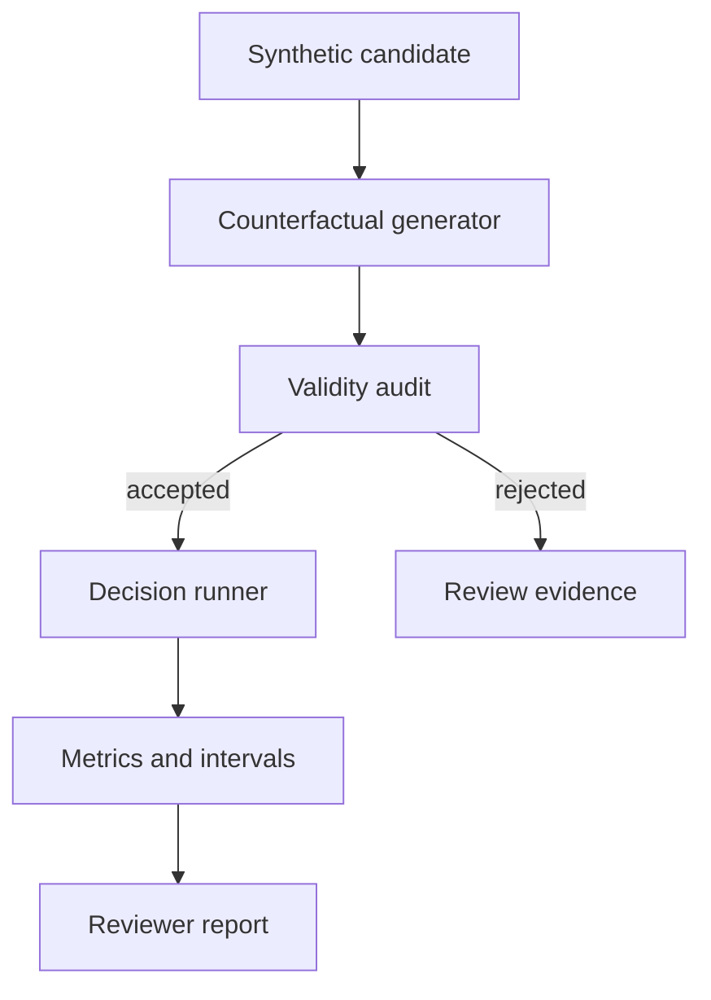

# ParityProbe

[](https://github.com/MadanMohan0537/counterfactual-fairness-audit/actions/workflows/ci.yml)

ParityProbe is a reproducible counterfactual fairness-audit workbench. It generates paired candidate records, verifies that swaps preserve task-relevant facts, measures decision flips and score gaps with uncertainty, and compares a mitigation against both fairness and task accuracy.

> **Project Lab traceability:** catalog Project 11, originally “Fairness Audit Workbench.” ParityProbe is the product name; this metadata prevents the renamed idea from being built twice.

## Implemented scope

- 48 reproducible synthetic hiring profiles with independent qualification labels.
- Counterfactual pairs for synthetic name group, gender marker, and regional zip proxy.
- Deterministic baseline and masked decision policies.
- Flip rate, score gap, selection-rate ratio, and pair denominators.
- Deterministic bootstrap confidence intervals.
- Mitigation comparison across fairness and accuracy.
- JSON and standalone HTML reviewer reports.
- **P1 counterfactual validity audit:** visible edited fields, invariant enforcement, linked-field consistency checks, and rejection before scoring.
- **P2 intersection coverage planner:** intersection denominators, Wilson uncertainty intervals, exact sample gaps, and explicit suppression of under-covered conclusions.

Real-person data, real demographic inference, legal conclusions, causal claims, hosted UI, and external-model credentials are intentionally excluded.

## Quick start

```bash
python -m venv .venv
source .venv/bin/activate
python -m pip install -e .
parityprobe --json parityprobe-report.json --html parityprobe-report.html
python -m unittest discover -s tests -v
```

No model, API key, paid service, network request, or personal data is required.

## Workflow



## Reproducible experiment

The frozen fixture contains a seeded name-group effect and a regional proxy effect. The masking mitigation removes the direct name-group treatment but deliberately leaves the proxy effect. The report therefore tests the product claim that “mask the name” is not a sufficient fairness strategy.

The P1 validity fixture includes four valid pairs and four invalid pairs: an invariant qualification change, inconsistent linked name fields, inconsistent zip/region fields, and a false edit declaration. Acceptance was set before execution: detect all invalid pairs and reject none of the valid controls.

The P2 coverage fixture contains a 12-pair well-covered control cell and a six-pair intersection with a seeded flip signal. Its predeclared acceptance test requires all denominators to reconcile, the sparse signal to remain visible, its conclusion to be suppressed, and the planner to recommend exactly six more cases. The minimum is a workflow policy, not a statistical power guarantee.

Results are a workflow demonstration, not evidence about a real model or population. See the [method and limitations](docs/METHOD.md).

## Responsible interpretation

- A counterfactual difference is an audit signal, not automatic proof of discrimination.
- The selection-rate ratio is reported descriptively; ParityProbe does not issue a legal verdict.
- Confidence intervals do not cover construct validity, label bias, or unmeasured context.
- Never infer protected attributes from real names or locations without a lawful, reviewed purpose.

## Roadmap

The next priority is a mitigation utility frontier that catches parity improvements achieved through indiscriminate rejection. The [rigorous backlog](docs/BACKLOG.md) documents the concrete user problem, behavior, dependencies, acceptance test, risks, and status of each extension.

## License

MIT

