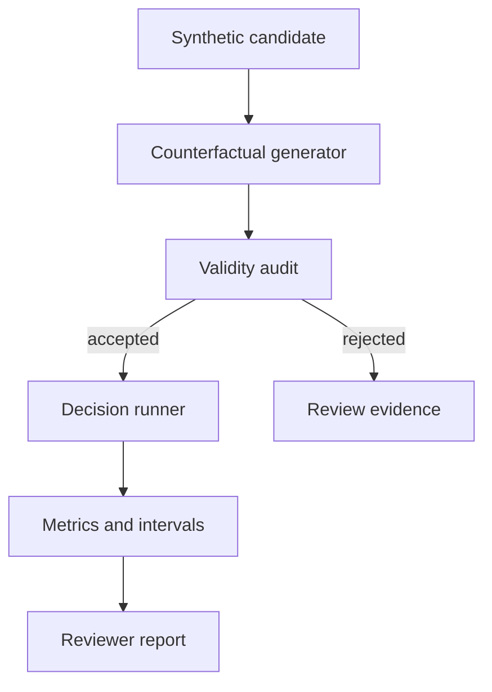

# Counterfactual Fairness Audit

[](https://github.com/MadanMohan0537/counterfactual-fairness-audit/actions/workflows/ci.yml)

**Test whether a decision policy changes its answer when only a sensitive attribute (or a proxy for one) changes, report the result with uncertainty, and check that a "fix" actually removes the effect.**

A reproducible Python workbench. The library imports only the standard library and declares no runtime dependencies. The package and CLI are still called `parityprobe`. The JSON report's `project` field and the HTML page title still say ParityProbe.

## Problem and who it's for

A common response to fairness concerns is "just mask the name". That can remove the direct effect and leave a proxy, such as location, doing the same work. Counterfactual tests are also easy to get wrong: if the swapped record also changes a qualification, the test measures the wrong thing. The intended readers are responsible-AI reviewers, ML practitioners, and the PMs or program managers who have to sign off on an automated screening step. This repository records no users and no review outcomes.

## Approach

1. Generate paired records that differ only in one attribute: a synthetic name group, a gender marker, or a regional zip-code proxy.
2. **Validate each pair before scoring.** Edited fields must be declared, task-relevant facts must not change, and linked fields (for example, zip and region) must stay consistent. Invalid pairs are rejected with the violation list attached.
3. Run a baseline and a masked decision policy, then measure the decision flip rate, mean score gap, and selection-rate ratio, with pair counts and a deterministic percentile bootstrap interval (the 2.5th and 97.5th percentiles of 800 resamples).
4. Compare the two policies on those rates and on task accuracy, and write a JSON report plus a standalone HTML page.



## What exists today

The fixture in `parityprobe/data.py` is synthetic. The figures below are the current CLI JSON (`parityprobe --json`) and the HTML page it writes. They were produced on Python 3.12.3. They describe this toy workflow only.

- 48 hiring profiles. The boolean qualification label is `(skill_score + 2 * experience_years) >= 76`. The text field `qualification` is `advanced` or `standard` from that same comparison.
- Three counterfactuals per profile (name group, gender marker, zip proxy), so the suite has 144 pairs. All 144 pass the validity audit (`rejected_generated_pairs` is 0).
- The baseline and masked policies are deterministic formulas in `parityprobe/decision.py`. Baseline applies a penalty when `name_group` is `group-b`. Both policies apply a penalty when `region` is `south`. The gender marker is unused by both formulas, and its flip rate is 0.0 on this fixture.
- Baseline JSON: overall flip rate 0.0903 on 144 pairs, bootstrap interval 0.0486–0.1458, mean score gap 0.0, selection-rate ratio 0.9851, accuracy 0.6667. Name-group flip rate 0.1667 on 48 pairs, with selection-rate ratio 1.0 because flips run in both directions. Zip-proxy flip rate 0.1042.
- Masked JSON: name-group flip rate 0.0. Zip-proxy flip rate 0.0833 on 48 pairs. Overall flip rate 0.0278, interval 0.0069–0.0556, mean score gap 0.0, selection-rate ratio 1.0, accuracy 0.75.
- The HTML page rounds the overall row to one decimal percent: baseline flip rate 9.0% and accuracy 66.7%; masked flip rate 2.8% and accuracy 75.0%. Attribute rates and bootstrap intervals are in the JSON.
- Validity fixture in `parityprobe/fixtures.py`: 8 cases, 4 invalid and 4 valid. The CLI and the HTML page both report 4 of 4 invalid pairs detected and 0 valid pairs rejected.
- 20 unit tests in `tests/test_parityprobe.py`. Running `python -m unittest discover -s tests -v` here reported 20 tests, OK. `.github/workflows/ci.yml` is configured to run those tests and the CLI on Python 3.11, 3.12, and 3.13. This environment executed 3.12.3 only.

## How success would be measured

Not yet measured. No outcome file, real-model evaluation, or reviewer-decision log is committed. The numbers in the previous section are the synthetic demo the CLI regenerates. The unit tests lock fixture checks (48 profiles, 144 pairs, labeled validity cases, a lower masked name-group flip rate, a masked zip-proxy flip rate above zero, and masked accuracy at least as high as baseline). Passing those tests is a workflow check on synthetic data.

| Measure | How it would be measured | Status |
|---|---|---|
| Seeded effects detected (direct and proxy) | Flip rates, pair counts, and bootstrap intervals for name group and zip proxy on a declared fixture | Not yet measured |
| Invalid counterfactual pairs caught before scoring | Misses and false rejections on labeled valid and invalid pairs | Not yet measured |
| Use on a real model or population | The same report on a real decision system and population | Not yet measured |
| Reviewer decisions changed by the report | Whether a sign-off changes after the report | Not yet measured |

## Limitations

- These results demonstrate the workflow on synthetic profiles and two hand-written policies. They are silent about any real model or population.
- A counterfactual difference is an audit signal. It is not proof of discrimination. The selection-rate ratio is descriptive. The tool does not issue a legal verdict. The HTML page says the same: "not a legal determination".
- The bootstrap interval is resampling variation on this fixture (flip-rate seed 11, score-gap seed 19, 800 draws). It does not cover construct validity, label bias, or unmeasured context.
- The repository includes no real-person data, no real demographic inference, no hosted UI, and no external model adapter. Inferring protected attributes from real names or locations needs a lawful, reviewed purpose.
- Mean score gap on this fixture is 0.0 for both policies, because each swap runs in both directions. The seeded effect shows up in the flip rate.

See [docs/METHOD.md](docs/METHOD.md) and [docs/BACKLOG.md](docs/BACKLOG.md). The next backlog item is an intersection coverage planner, and it is still planned: show group counts and interval width, and withhold a conclusion when a subgroup is too small to support one.

## Quick start

Requires Python 3.11 or newer, with the standard-library `venv` module. The audit uses no model, API key, or personal data. The `parityprobe` command makes no network calls. `pip install` may download the setuptools build backend named in `pyproject.toml`.

`python` is not on `PATH` on every machine until the virtual environment exists. Create the environment with `python3`.

```bash
git clone https://github.com/MadanMohan0537/counterfactual-fairness-audit.git
cd counterfactual-fairness-audit
python3 -m venv .venv
source .venv/bin/activate
python -m pip install -e .
python -m unittest discover -s tests -v
parityprobe --json parityprobe-report.json --html parityprobe-report.html
```

The JSON and HTML paths are gitignored.

## Deployment

Cloudflare Workers is the planned target. This repository has no Workers configuration, and it is not deployed.

`npx wrangler deploy` is the deploy command once a Worker exists. Before that command can succeed, the repository needs:

- a `wrangler.toml`
- a Worker entry point
- Python Workers, or a JavaScript or TypeScript port of this library

```bash
npx wrangler deploy
```

## License

MIT. See [LICENSE](LICENSE).
